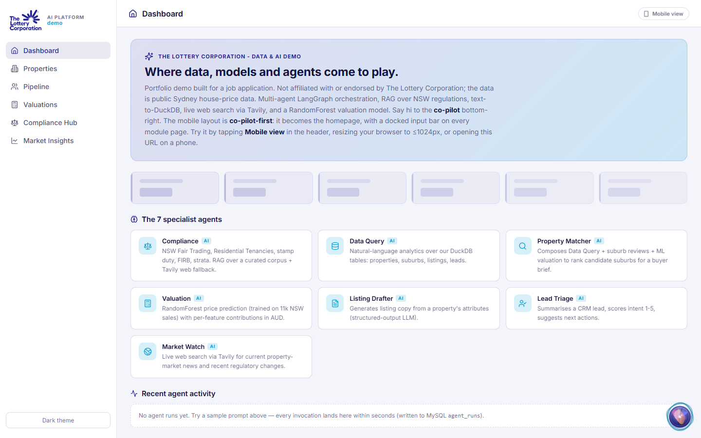

# lotterycorp-data-ai-platform

A data and AI platform demo built by Owen Wen for an application to The
Lottery Corporation (Senior Data & AI Engineer, Brisbane, November 2026).
**It is not affiliated with, endorsed by or connected to The Lottery
Corporation.** The company's name and visual identity are used only to
show how the work would look in their colours; the data is public Sydney
house-price data, and every number on screen is computed from it.

What it shows, end to end:

- **Source to model to question.** MySQL is the governed source of truth.
  An idempotent ETL (`scripts/etl_mysql_to_duckdb.py`) rebuilds a DuckDB
  analytics store of pre-joined wide tables, safe to schedule or trigger
  after writes land. A text-to-SQL agent queries it behind a SELECT-only
  validator with a table allowlist.
- **Reusable AI components.** Eight LangGraph agents share one
  structured-output contract: every node returns a Pydantic object, and
  free text never enters graph state. A one-file provider dispatcher
  (`services/llm.py`, `services/embed.py`) swaps chat and embedding
  back-ends by flag. The harness enforces a 30 s per-node timeout, 90 s
  end to end, one retry on validation errors.
- **Evaluation as a gate.** 47 unit tests and a 7-case smoke eval suite run
  on every pull request; the full judged suite (14 cases, LLM-as-judge
  against a rubric) runs weekly. See [`evals/README.md`](evals/README.md).
- **Infrastructure as code, no static keys.** The Azure estate is
  Terraform. Images are built by GitHub Actions and pulled by Azure
  Container Apps; secrets live in Key Vault and are read through a managed
  identity. The app scales to zero and costs cents at rest.
- **RAG with citations, live web search, and a RandomForest valuation
  model** with per-feature contributions, so the agents have real tools to
  call.



## Architecture

```
/orb/chat (SSE)  ->  Planner (LLM, typed decision; keyword fallback)
                        |
   Compliance  Data Query  Matcher  Valuation  Listing  Lead Triage  Market Watch  General
   (RAG +      (text-to-   (3 tools) (sklearn)  (LLM)    (LLM)        (Tavily)      (LLM)
    Tavily)     DuckDB)
                        |
                 Summariser (LLM)  ->  final_message
```

- **Backend:** FastAPI, LangGraph, Pydantic, DuckDB, MySQL (SQLAlchemy +
  PyMySQL), scikit-learn, Tavily. Chat on Gemini (`gemini-3.5-flash-lite`),
  embeddings on Azure OpenAI (`text-embedding-3-small`), both over the
  OpenAI-compatible protocol.
- **Frontend:** React 18, Vite 5, React Router 7, Recharts, Leaflet.
  Mobile-first; the co-pilot becomes the home page under 1024 px.
- **Deployment:** one Container App with nginx and FastAPI as sidecars
  (same origin, one cold start), MySQL Flexible Server, Blob for the model
  and RAG parquets, Key Vault + managed identity. Terraform in
  [`infra-azure/tlc/`](infra-azure/tlc/).

## Run locally

```powershell
docker compose up -d mysql

cd backend
uv sync
uv run python ../scripts/seed_all.py          # migrate + load MySQL + ETL to DuckDB
uv run python ../scripts/train_model.py
uv run python ../scripts/build_review_embeddings.py
uv run python ../scripts/build_regulation_corpus.py
uv run uvicorn src.main:app --reload --port 8000

cd ../frontend
npm install
npm run dev                                   # http://localhost:5173
```

Copy `.env.example` to `.env` and fill the LLM, embedding and Tavily keys.
Tests: `cd backend && uv run pytest`. Smoke evals against a running
backend: `uv run python ../evals/run.py --tier smoke`.

## Deploy

`.github/workflows/deploy.yml` builds and publishes the two images on every
push to `main`. The container app is created from Azure Cloud Shell with
the Terraform root in `infra-azure/tlc/`; the runbook is
[`infra-azure/tlc/README.md`](infra-azure/tlc/README.md).

## Repo map

```
backend/src/app/routers/     thin handlers, one file per page group
backend/src/app/services/    SQL, LLM dispatch, RAG, agents (LangGraph)
frontend/src/pages/          one file per route, auto-discovered
scripts/                     data, model and corpus builds; MySQL -> DuckDB ETL
evals/                       three-tier eval suite + CI gate
infra-azure/tlc/             Terraform for the container app
```

## Credits

Sydney house-price data from Kaggle. NSW regulation excerpts from public
Revenue NSW and Fair Trading pages. `react-ai-orb` (MIT) re-skinned for
the orb. Built and maintained by Owen Wen.
